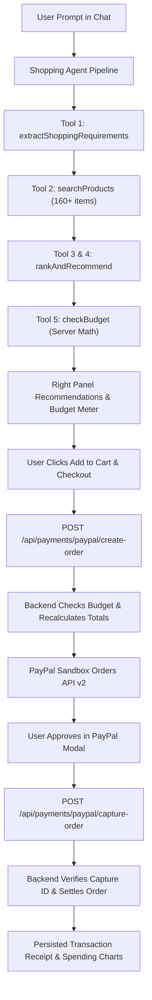

# PayPilot
### Your AI. Your Budget. Your Purchase.

[](https://opensource.org/licenses/MIT)
[](https://developer.paypal.com/)
[](https://aistudio.google.com/)
[](#14-testing--sandbox-verification)
[](#)

> **PayPal AI Hackathon Submission**  
> An autonomous AI shopping assistant that extracts natural-language requirements, queries verified catalog data, enforces financial spending guardrails, and completes real transactions via the **PayPal Developer Platform (Orders API v2)**.

---

## 1. Project Title
**PayPilot — Autonomous AI Shopping Copilot with PayPal Sandbox Integration**

---

## 2. Project Overview
PayPilot transforms traditional, tedious e-commerce search into an intelligent, guarded purchasing experience. Instead of scrolling through hundreds of filtered pages and guessing whether an item fits their budget, users state their needs in plain English. 

PayPilot's AI agent:
- Understands requirements and extracts key constraints (category, budget, technical preferences).
- Queries a controlled, realistic 160-product catalog across 10 categories.
- Evaluates technical trade-offs and generates ranked match recommendations.
- Validates purchases against user-authorized monthly budget ceilings.
- Initiates and verifies real checkout through the **PayPal Developer Platform (Orders API v2)**.

---

## 3. Problem Statement
Online shopping currently suffers from two major friction points:
1. **Decision Fatigue & Spec Overload:** Consumers spend hours comparing technical specifications across tabs, unsure if a product actually satisfies their requirements.
2. **Impulse Overspending & Lack of Budget Controls:** E-commerce carts lack guardrails. Shoppers frequently overspend without real-time tracking against personal monthly limits.

Traditional chatbots only generate superficial conversational text without actual catalog validation, server-side math, or payment execution.

---

## 4. Proposed Solution
PayPilot implements a **four-pillar architecture**:
- **AI Handles Shopping Intelligence:** Natural-language requirement extraction, specification matching, and transparent recommendations.
- **Backend Enforces Financial Rules:** Immutable price snapshotting, mathematical total calculations, and hard budget ceilings.
- **User Controls Payment Authorization:** Explicit review of cart items and budget runway before payment.
- **PayPal Settles the Transaction:** Server-to-server OAuth 2.0 authorization, order creation, and capture verification.

---

## 5. Key Features

- **Split-Screen AI Shopping Interface:** Desktop layout with AI dialogue (~60%) on the left and live recommendation cards + real-time budget progress bar (~40%) on the right.
- **160+ Item Verified Catalog Across 10 Categories:** Headphones, Laptops, Smartphones, Keyboards, Smartwatches, Monitors, Speakers, Tablets, Cameras, Accessories.
- **Browse All Products & Strict Catalog Truth:** Full multi-facet catalog browser (category, brand, price slider, sorting). Users can ask the AI about *any* catalog product, and the AI answers strictly from verified database records.
- **Multi-Factor Product Comparison:** Side-by-side comparison matrix highlighting differences in price, battery life, performance, and warranty.
- **Server-Side Budget Guardrails:** Blocks checkout attempts that exceed user-configured monthly limits, giving clear financial reasoning.
- **PayPal Orders API v2 Integration:** Server-side order creation (`/v2/checkout/orders`), official JavaScript SDK approval buttons, server-side capture verification, and duplicate capture prevention.
- **Persisted Order Receipts & Analytics:** Real database-backed transaction history and expenditure charts powered by **Recharts**.

---

## 6. Architecture & System Flow



See [docs/architecture.md](docs/architecture.md) for full sequence diagrams and threat model.

---

## 7. Technology Stack

### Frontend
- **Framework:** React 18 with TypeScript and Vite
- **Styling & Design:** Tailwind CSS (Clean Fintech Minimalism + Emerald Green `#047857`)
- **Routing:** React Router v6
- **Data Visualization:** Recharts (AreaChart, PieChart, BarChart)
- **Icons:** Lucide React
- **Payments:** `@paypal/react-paypal-js`

### Backend
- **Runtime:** Node.js (v18+) with Express.js and TypeScript (`tsx`)
- **API Architecture:** REST API with centralized error handling
- **Schema Validation:** Zod
- **Security:** Helmet, CORS, Express Rate Limiting

### AI Provider
- **Model:** Google Gemini 2.5 Flash (`@google/generative-ai`)
- **Fallback Engine:** Embedded semantic NLP parser for zero-configuration local evaluations.

### Payments
- **Platform:** PayPal Developer Platform (Sandbox)
- **Protocol:** PayPal Orders API v2 (`CAPTURE` intent)

### Database & Persistence
- **Production:** Supabase / PostgreSQL (Full SQL schema & RLS in `database/migrations/`)
- **Local/Demo:** Dual-mode local repository provider with identical interface for zero-friction evaluation.

---

## 8. AI Model & How It Is Used

PayPilot utilizes **Google Gemini 2.5 Flash** for:
1. **Natural-Language Understanding:** Extracting structured parameters (`category`, `budget`, `currency`, `preferences`, `brand_preference`) from conversational sentences.
2. **Multi-Factor Recommendation Scoring:** Evaluating requested attributes against detailed hardware specifications to calculate match scores (0–100) and budget fit ratings (`well_within`, `at_budget`, `slightly_over`).
3. **Strict Catalog Q&A:** Answering user queries about specific items (battery life, display specs, warranty) strictly grounded in database records. The AI explicitly declines to invent missing data.

---

## 9. PayPal Integration Details

PayPilot implements a compliant server-side PayPal workflow:
- **`POST /api/payments/paypal/create-order`**: Backend obtains an OAuth 2.0 access token via HTTP Basic Auth (`client_id:client_secret`), recalculates cart items from database snapshots, validates user budget, and calls PayPal Orders API v2 (`/v2/checkout/orders`).
- **`POST /api/payments/paypal/capture-order`**: Captures funds server-side via `/v2/checkout/orders/{id}/capture`, verifies capture status, and prevents duplicate captures.
- **`GET /api/payments/paypal/order/:orderId`**: Retrieves live order status from PayPal Sandbox.

*Security Notice: The PayPal client secret is never bundled in frontend code.*

---

## 10. Installation Instructions

### Prerequisites
- Node.js (v18.0 or newer)
- npm (v9.0 or newer)
- Git

### Clone & Install
```bash
# Clone the repository
git clone https://github.com/aditi-web-creator/paypilot.git
cd paypilot

# Install all monorepo dependencies (root, backend, frontend)
npm run install:all
```

---

## 11. Environment Configuration

Copy the example environment template:
```bash
cp .env.example .env
```

Edit `.env` (or configure in `backend/.env` and `frontend/.env`):
```env
# Server
PORT=5000
NODE_ENV=development
CORS_ORIGIN=http://localhost:5173

# AI Provider (Google Gemini API)
GEMINI_API_KEY=your_gemini_api_key_here
GEMINI_MODEL=gemini-2.5-flash

# PayPal Developer Sandbox
PAYPAL_CLIENT_ID=your_paypal_sandbox_client_id_here
PAYPAL_CLIENT_SECRET=your_paypal_sandbox_client_secret_here
PAYPAL_BASE_URL=https://api-m.sandbox.paypal.com
PAYPAL_CURRENCY=USD

# Frontend Public Variables
VITE_API_BASE_URL=http://localhost:5000/api
VITE_PAYPAL_CLIENT_ID=your_paypal_sandbox_client_id_here
```

*Note: If `GEMINI_API_KEY` or `PAYPAL_CLIENT_ID` are omitted, PayPilot automatically runs in its intelligent local simulation mode so judges can evaluate the entire application out-of-the-box!*

---

## 12. Local Development Instructions

Start both the backend server and frontend development client concurrently:
```bash
npm run dev
```

- **Frontend:** `http://localhost:5173`
- **Backend API:** `http://localhost:5000`
- **API Health Check:** `http://localhost:5000/api/health`

---

## 13. Database Setup

### Automated Local Store
PayPilot includes an embedded, high-performance database repository that persists profiles, budgets, carts, orders, and sessions to `backend/data/store.json` without requiring external setup.

### Supabase / PostgreSQL Setup (Optional)
To use a remote Supabase instance:
1. Create a Supabase project at [supabase.com](https://supabase.com).
2. Execute `database/migrations/001_initial_schema.sql` in the Supabase SQL Editor.
3. Execute `database/seed.sql` to populate the 160 products and demo user.
4. Set `SUPABASE_URL` and `SUPABASE_SERVICE_ROLE_KEY` in `.env`.

---

## 14. Testing & Sandbox Verification

PayPilot includes a complete automated test suite covering all 6 milestones:
```bash
npm test
```

### Verified Test Suite (17 Tests Passed):
- `Health Check Endpoint`: Validates API health, mode, and configurations.
- `Catalog & Product Provider`: 10 categories, >= 150 products, category & price filtering, spec extraction, side-by-side comparison matrix.
- `AI Shopping Agent`: Structured requirement extraction, multi-factor recommendation ranking, strict catalog Q&A.
- `Shopping Cart & Budget Enforcement`: Server-side subtotal/tax/shipping recalculation, budget validation, and 422 checkout blocking when over budget.
- `PayPal Orders API v2`: Server order creation, capture verification, and duplicate capture prevention.
- `Dashboard & Spending Analytics`: Real persisted expenditure records and category metrics.

---

## 15. UI Walkthrough

- **Landing Page (`/`):** Clean fintech typography, hero section, interactive demo widget preview, architectural separation of concerns, and feature breakdown.
- **Dashboard (`/dashboard`):** Real-time spending progress, monthly budget card, completed purchases, Recharts expenditure trend, and category donut chart.
- **AI Shopping Assistant (`/ai-shopping`):** Desktop split-screen interface with natural-language chat on the left, genuine backend execution activity steps, and live recommendation cards + real-time budget meter on the right.
- **Browse Products (`/browse`):** Full 160-item catalog with search, category tabs, brand filters, price range sliders, and product comparison drawer.
- **Shopping Cart (`/cart`):** Quantity controls, verified price snapshots, tax and free shipping calculations, and strict budget limit validation.
- **PayPal Checkout (`/checkout`):** Real-time PayPal approval buttons, server-side capture verification, verified Order ID and Capture ID receipt.
- **Order History (`/orders`):** Filterable transaction log of all verified captures with receipt modals.
- **Budget & Spending (`/budget`):** Interactive budget ceiling editor that persists to the database and enforces limits during checkout.

---

## 16. Demo Workflow

For judges evaluating PayPilot, follow the 1-click test scenarios in **Help & Demo Guide (`/help`)**:
1. Open `/help` and click **"Run Judging Demo"**.
2. Notice the assistant automatically extracts requirements for headphones under $150 with ANC and battery life.
3. Review recommendations on the right panel, select an item, and click **"Add to Cart"**.
4. Proceed to **PayPal Checkout** and click the PayPal authorization button (or the one-click **"Simulate Verified Sandbox Approval"** button).
5. Verify the captured receipt and open **Overview** (`/dashboard`) to see the expenditure reflect in the analytics charts!

---

## 17. Known Limitations
- PayPal Sandbox test accounts occasionally experience latency during peak sandbox hours; PayPilot includes graceful timeout and retry handling.
- Demo catalog is scoped to 160 realistic consumer electronics items; external production inventories (e.g. Channel3 or live retailer APIs) can be connected via the implemented `IProductProvider` interface.

---

## 18. Future Improvements
- Multi-currency live exchange rate synchronization via European Central Bank API.
- Integration of live webhooks (`PAYMENT.CAPTURE.COMPLETED`) for asynchronous order status updates.
- Expansion of the `IProductProvider` interface to support real-time retail feeds.

---

## License
MIT License. Copyright (c) 2026 PayPilot Contributors. See [LICENSE](LICENSE) for details.
