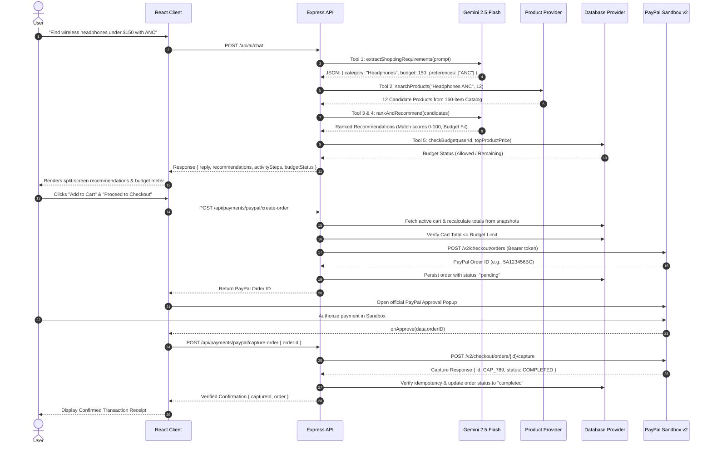

# PayPilot Architecture Documentation

## 1. High-Level System Overview

**PayPilot** is an autonomous AI shopping assistant that integrates natural-language requirement extraction, multi-factor product matching, financial budget guardrails, and real-time checkout through the **PayPal Developer Platform (Orders API v2)**.

```
+-----------------------------------------------------------------------------------+
|                                  USER / CLIENT                                    |
|                                                                                   |
|  +---------------------------+   +---------------------------------------------+  |
|  |     AI Shopping Chat      |   |   Live Recommendations & Cart Guardrails    |  |
|  |  (Split-Screen Copilot)   |   |   (Catalog Matching, Specs, Budget Meter)   |  |
|  +---------------------------+   +---------------------------------------------+  |
+-----------------------------------------------------------------------------------+
                                       |
                 REST API Requests (JSON / Auth Headers)
                                       v
+-----------------------------------------------------------------------------------+
|                               PAYPILOT BACKEND API                                |
|                                                                                   |
|  +--------------------+   +-----------------------+   +------------------------+  |
|  | Shopping Agent     |   | Catalog Engine        |   | Budget Enforcement     |  |
|  | (9 Tool Pipeline)  |   | (160+ Items, 10 Cats) |   | (Non-bypassable Guard) |  |
|  +--------------------+   +-----------------------+   +------------------------+  |
+-----------------------------------------------------------------------------------+
          |                               |                           |
          v                               v                           v
+-------------------+           +-------------------+       +--------------------+
|  Google Gemini    |           |    PostgreSQL /   |       |   PayPal Sandbox   |
|  2.5 Flash API    |           |  Supabase Store   |       |   Orders API v2    |
| (NLU Extraction)  |           | (Persistence RLS) |       | (Capture & Verify) |
+-------------------+           +-------------------+       +--------------------+
```

---

## 2. Core Architectural Separation of Concerns

PayPilot strictly isolates responsibilities to enforce fintech security:

| Domain | Role | Constraints & Boundaries |
| :--- | :--- | :--- |
| **AI Agent** | Understanding requirements, matching specs, explaining recommendations, Q&A on catalog items. | **CANNOT** capture payments, change budgets, bypass user approval, or hallucinate outside catalog records. |
| **Backend Core** | Mathematical cart calculations, price snapshotting, budget validation, token management. | Validates all requests via Zod. Recalculates cart totals on the server before calling PayPal. |
| **User Authority** | Explicit purchase authorization. | Inspects cart, reviews budget impact, and approves PayPal checkout popup. |
| **PayPal Platform** | Financial settlement and capture verification. | Orders API v2 (`/v2/checkout/orders` and `/v2/checkout/orders/{id}/capture`). |

---

## 3. Autonomous Shopping Agent Workflow



---

## 4. The 9 Controlled AI Tools

1. **`extractShoppingRequirements`**: Extracts category, numeric budget, currency, and preferences via structured JSON schema.
2. **`searchProducts`**: Queries 160+ items across 10 categories with multi-term token scoring.
3. **`compareProducts`**: Builds an attribute matrix across 2-4 products with difference highlighting.
4. **`explainRecommendation`**: Explains technical specifications and match reasons strictly using catalog data.
5. **`checkBudget`**: Computes projected total expenditure and checks against the user's spending limit.
6. **`prepareCart`**: Prepares and populates cart items based on recommended selections.
7. **`getCartSummary`**: Returns hydrated cart items and calculated subtotal, shipping, and tax.
8. **`getProductDetails`**: Retrieves complete verified catalog record for any product by ID or name.
9. **`browseCatalog`**: Provides filtered, paginated catalog exploration across all 160 products.

---

## 5. Security & Threat Modeling

1. **Client Price Tampering Prevention**: The frontend never supplies unit prices to checkout. Cart totals are computed server-side using immutable database snapshots.
2. **AI Boundary Enforcement**: AI outputs are strictly recommendations; execution requires explicit user authorization and server-side budget checks.
3. **Duplicate Capture Prevention**: Idempotent capture records prevent duplicate capture calls on already-settled transactions.
4. **Secret Isolation**: PayPal Client Secret and Gemini API keys reside exclusively in server environment variables. Zero exposure in Vite client bundles.
